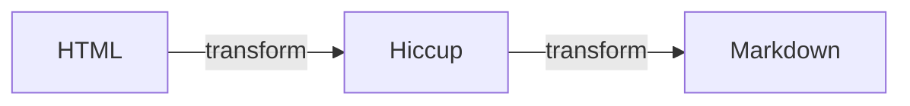

# html-to-md

A Clojure library for converting HTML (e.g. from websites)
into clean Markdown that is both human readable and LLM token-efficient.

[](https://book.babashka.org#badges)


## Usage

```clojure
(require '[html-to-md.core :as html-to-md])

(html-to-md/convert "<h1>Some heading</h1> <p>Followed by some text</p>")
; "# Some heading\n\nFollowed by some text"
```

## Install

Use it as a cli tool via `bbin`:

    bbin install https://github.com/jacobemcken/html-to-md.git

The use it like:

    html-to-md https://www.emcken.dk


## Development

### Test suite

Running test suite using vanilla Clojure:

    clj -X:test

Running test suite using Babashka:

    bb test


### Build

Build the artifact:

    clj -T:build

Install in local Maven cache:

    clj -T:build install


## Architecture

The library consists of two transformation layers:



An existing library [Hickory][1] already handles HTML to Hiccup conversion quite well,
**so this library just uses Hickory and focuses on Hiccup to Markdown conversion**.
But includes Hickory as a dependency for convenience.

To be able to generate "good looking" Markdown (without unnecessary whitespace),
content is categorized as either "inline" or "block" content.
The [content categories are borrowed from CSS because][2] they have some conceptual overlap.
Block content uses newlines to distance itself from other content.
Inline content uses space to distance itself from other content.


### Examples

Notice how irrelevant whitespace is trimmed in the following examples.

#### Example 1 - inline content

```html
<span> Some text</span><span>!</span>   <span>More</span><span> text</span>.
```

becomes:
```
Some text! More text.
```

#### Example 2 - block content

```html
<p>Some text!</p><p>More text,
across multiple lines.</p>
```

becomes:
```
Some text!

More text,
across multiple lines.
```

#### Example 3 - mixed content (complicated)

```html
<ul>
  <li>Apple</li>
  <li>Banana
    <ol>
      <li>The <code>yellow</code> one.</li>
      <li><div><blockquote><p>A <em>sunflower</em> would 
          <span style="color:purple;">be jealous</span>.
          </p><p><strong>Even</strong><br>the sun.</p></blockquote></div></li>
    </ol>
  </li>
  <li>Kiwi</li>
</ul>
```

becomes:
```
-   Apple
-   Banana
    1.  The `yellow` one.
    2.  > A _sunflower_ would be jealous.
        > 
        > **Even**  
        > the sun.
-   Kiwi
```

### Technical implementation

There are two dimensions of complexity that the implementation needs to account for:
-   Prefixes related to nesting: lists within blockquotes within lists
-   Spacing
    -   Horizontal between inline content
    -   Vertical between block content

All content that isn't block content is considered inline.
Block content:

- Paragraphs (`:p` & `:div`)
- Headers (`:h1` - `:h6`)
- Lists (`:ul` & `:ol`)
- List elements (`:li`)
- Blockquotes (`:blockquote`)
- Preformatted (`:pre`)
- Horizontal ruler (`:hr`)
- Tables

A few examples of inline content:

- Links (`:a`) - also known as hyperlinks or anchors.
- Emphasis (`:em`)
- Code (`:code`)
- and many more...

[1]: https://github.com/clj-commons/hickory
[2]: https://developer.mozilla.org/en-US/docs/Web/CSS/Guides/Display/Block_and_inline_layout
