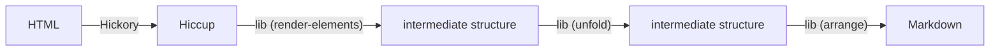

# Architecture

The library consists of several transformation layers:

An existing library [Hickory][1] already handles HTML to Hiccup conversion quite well,
**so this library just uses Hickory and focuses on Hiccup to Markdown conversion**.
But includes Hickory as a dependency for convenience.

To generate "good looking" Markdown (without unnecessary whitespace),
the implementation needs to account for:
-   Prefixes related to nesting, e.g. lists within blockquotes within lists
-   Spacing
    -   Horizontal between inline content
    -   Vertical between block content

The [content categories *inline* and *block* are borrowed from CSS][2],
because they have some conceptual overlap.
Inline content uses space to distance itself from other content.
Block content uses newlines to distance itself from other content.

All content that isn't block content is considered inline.

Block content:

- Paragraphs (`:p` & `:div`)
- Headers (`:h1` - `:h6`)
- Lists (`:ul` & `:ol`)
- List elements (`:li`)
- Blockquotes (`:blockquote`)
- Preformatted (`:pre`)
- Horizontal ruler (`:hr`)
- Tables

A few examples of inline content:

- Links (`:a`) - also known as hyperlinks or anchors.
- Emphasis (`:em`)
- Code (`:code`)
- and many more...

## Data structures

The intermediate data structure between hiccup and markdown text,
found in `html-to-md.hiccup-to-md` is handled by:

1.  `render-elements` converts hiccup to **Flow elements** (*Inline* & *Block*),
    and `splice` joins adjacent *inline elements* to simplify the structure.
2.  `unfold` flattens *Flow elements* into **Lines**;
3.  `arrange` joins *Lines* into markdown text.

### Flow elements

Two shapes:

**Inline** — a map with whitespace margins and text:

    {:left 0 :right 0 :text "Apple"}

- `:left` / `:right` — spaces (0 or 1) the element wants on each side.
- `:text` — the content, or `nil` for a whitespace-only element:
  `{:left 1 :right 1 :text nil}`.

Inline content will only ever create a single space to adjacent inline content,
regardless of how much space exists in the HTML (`pre` tags are the exception).

**Block** — a vector: `:block` tag, attrs map, then children:

    [:block {:spacing ::block :prefix ("> " "> " ...)}
     {:left 0 :right 0 :text "Apple"}]

- `:spacing` — vertical spacing policy: `::always`, `::block`, or `::text`
  (see *Gluing it all together*).
- `:prefix` — optional, infinite sequence of per-line prefix strings.
  `...` in the prefix sequence represents infinity.

### Lines

A map representing what will become a line in the text (string):

    {:text "Apple"
     :margins {:before ::block :after ::text}
     :prefix [("> " "> " ...) ("-   " "    " ...)]}

- `:margins` — vertical spacing keywords based on *Block* spacing, above and below.
- `:prefix` — a vector of prefix sequences, one per nesting level.

The spacing of the first block's `:before` and last block's `:after` inside a block
is inherited from the parent, instead of coming from the child's own `:spacing`.

### Gluing it all together

`arrange` renders lines into markdown adhering to the vertical spacing policy of `:margins`
and prefixes every text line.

**Spacing**

- `::always` — always a blank line above/below, regardless of the neighbor.
  Used by headings, paragraphs (`:p`), `:hr`, and tables.
- `::block` — a blank line above/below only if the neighbor is also `::block`.
  Used by `:ul`, `:ol`, `:pre`, and `:blockquote`.
- `::text` — never a blank line above/below.
  Used by `:li`, so list items pack tightly together.

[1]: https://github.com/clj-commons/hickory
[2]: https://developer.mozilla.org/en-US/docs/Web/CSS/Guides/Display/Block_and_inline_layout

